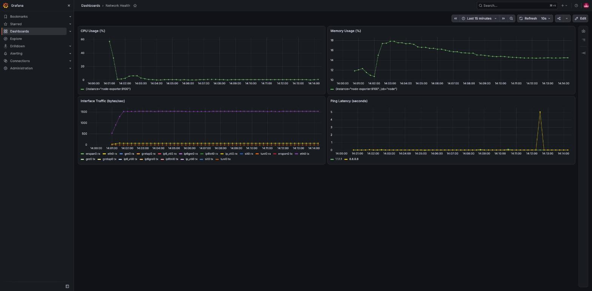

# Day 12 — Grafana Monitoring

## Objective
Build a working monitoring pipeline — metrics collection, storage, and visualization — rather than just clicking through Grafana's UI with sample data. Four panels required: CPU, memory, interface traffic, and ping latency.

## Stack

| Component | Role |
|---|---|
| `node_exporter` | exposes host CPU, memory, and network interface metrics |
| `blackbox_exporter` | runs ICMP probes against external targets, exposes latency as a metric |
| `prometheus` | scrapes both exporters on a 10s interval, stores the time series |
| `grafana` | queries Prometheus, renders the dashboard |

All four run as containers on a dedicated Docker network (`day12net`) so they can resolve each other by name.

## Configuration

Prometheus scrape config — one static job for `node_exporter`, and a relabeled job that turns a list of IPs into blackbox probe targets:

```yaml
scrape_configs:
  - job_name: node
    static_configs:
      - targets: ["node-exporter:9100"]

  - job_name: blackbox_icmp
    metrics_path: /probe
    params:
      module: [icmp]
    static_configs:
      - targets: [8.8.8.8, 1.1.1.1]
    relabel_configs:
      - source_labels: [__address__]
        target_label: __param_target
      - source_labels: [__param_target]
        target_label: instance
      - target_label: __address__
        replacement: blackbox-exporter:9115
```

Blackbox needs its own module definition — the default image ships with an HTTP module, not ICMP:

```yaml
modules:
  icmp:
    prober: icmp
    timeout: 5s
    icmp:
      preferred_ip_protocol: "ip4"
```

ICMP probing requires raw sockets, so the blackbox container runs with `--cap-add=NET_RAW`.

## Verification

Confirmed all three scrape targets reporting healthy before touching Grafana:

```
job: blackbox_icmp   instance: 8.8.8.8          health: up
job: blackbox_icmp   instance: 1.1.1.1          health: up
job: node            instance: node-exporter:9100  health: up
```

Added Prometheus as a Grafana datasource and imported a dashboard with four panels, built from these queries:

- **CPU Usage (%)** — `100 - (avg(rate(node_cpu_seconds_total{mode="idle"}[1m])) * 100)`
- **Memory Usage (%)** — `100 * (1 - (node_memory_MemAvailable_bytes / node_memory_MemTotal_bytes))`
- **Interface Traffic (bytes/sec)** — `rate(node_network_receive_bytes_total[1m])` / transmit equivalent
- **Ping Latency (seconds)** — `probe_duration_seconds{job="blackbox_icmp"}`



All four panels are populated with live data, not static sample values — the ping latency panel shows a real spike from one probe cycle (~5s vs. a steady baseline near 0), and CPU shows an initial spike settling to a steady baseline as the container finished starting up.

## Checklist
- [x] Deploy node_exporter and confirm Prometheus scrapes it successfully
- [x] Deploy blackbox_exporter with a custom ICMP module and confirm probes succeed
- [x] Connect Grafana to Prometheus as a datasource
- [x] Build a dashboard with CPU, memory, interface traffic, and ping latency panels
- [x] Confirm all panels render real, non-empty time series data
